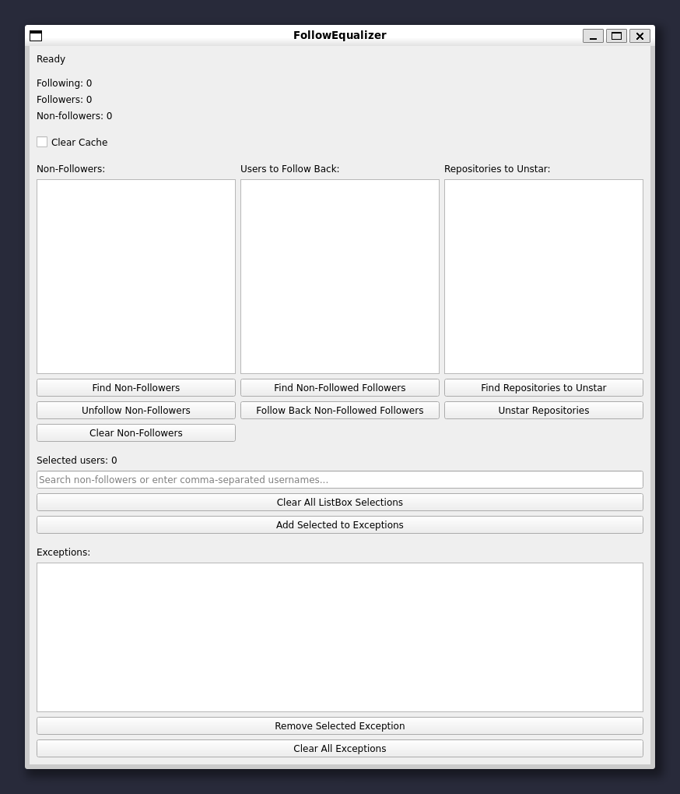
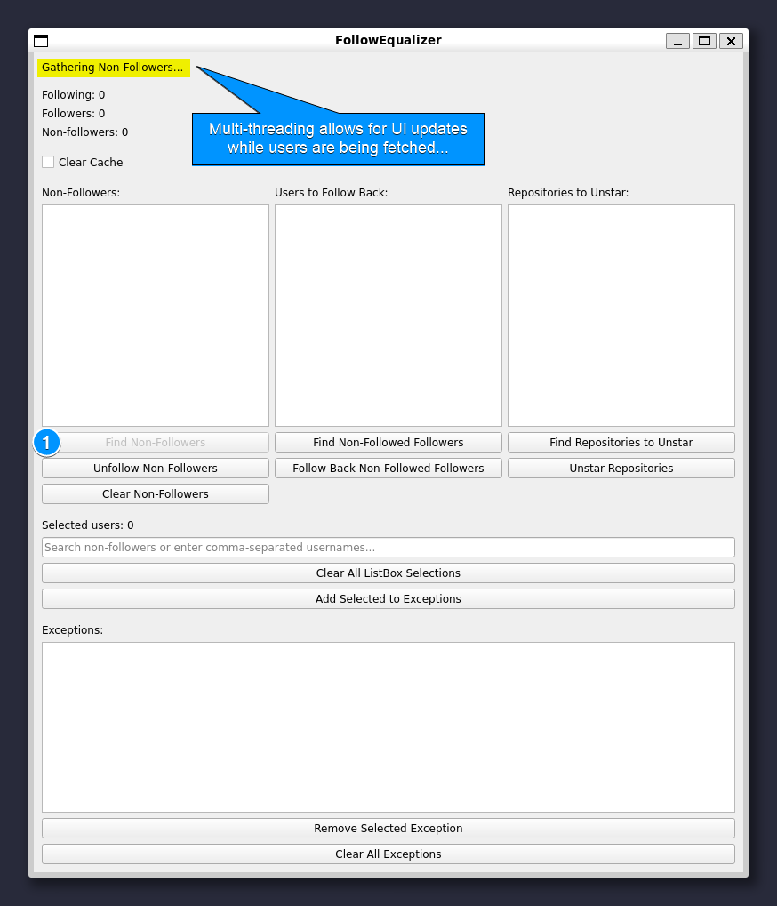
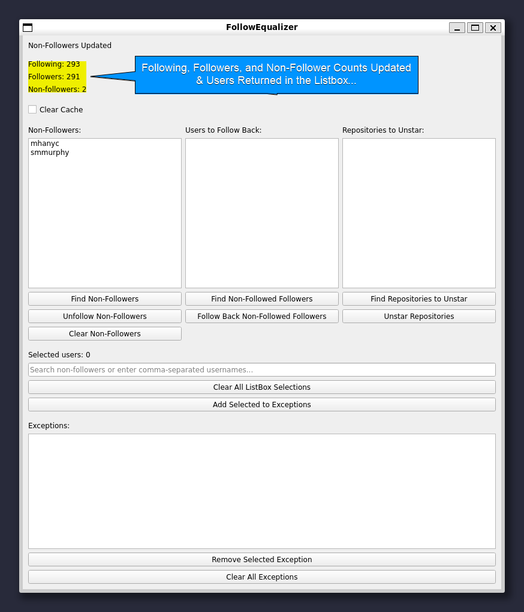
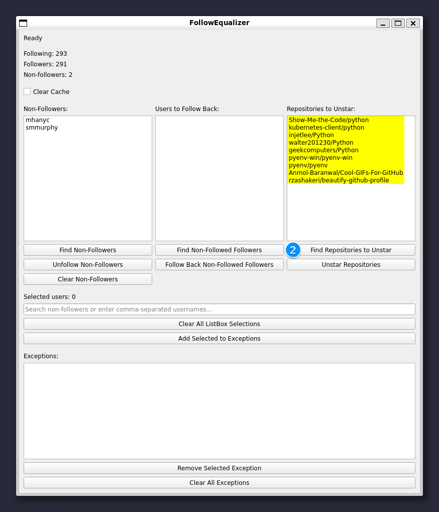
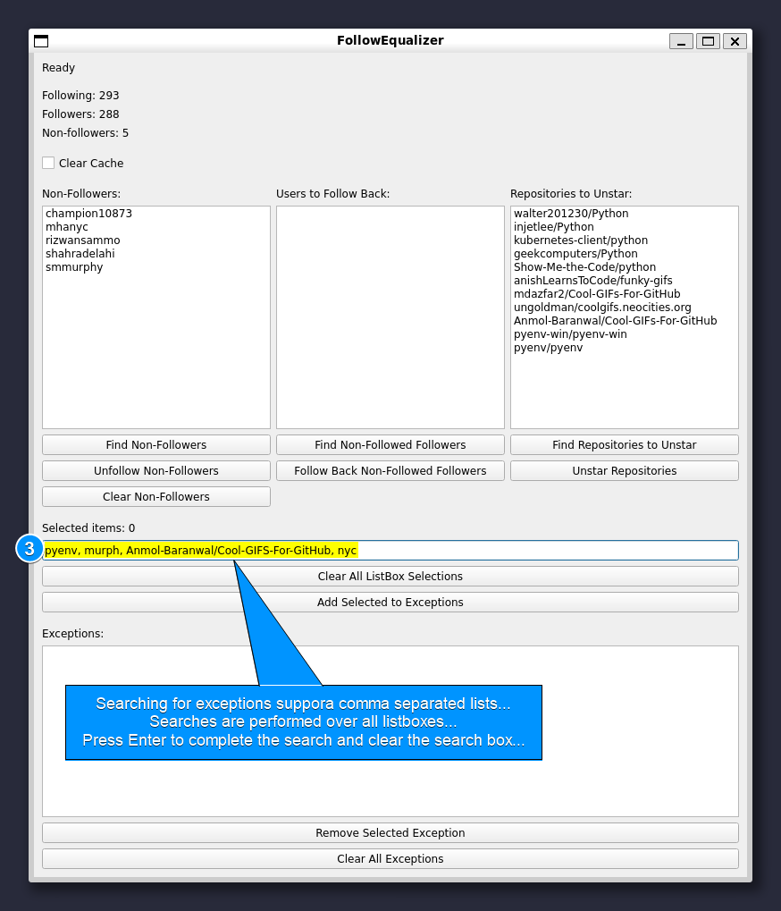
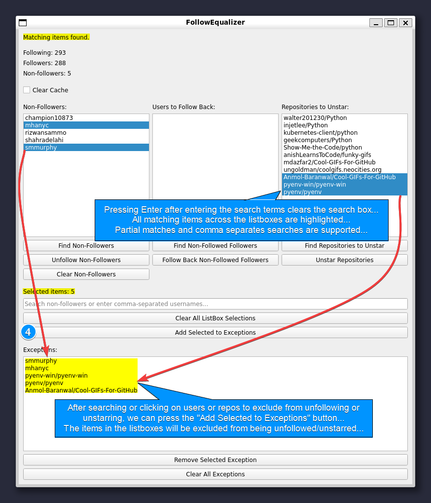
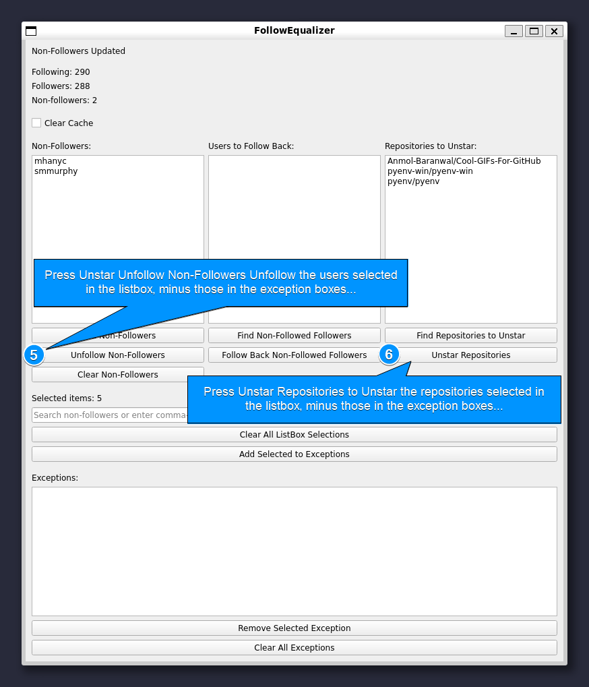
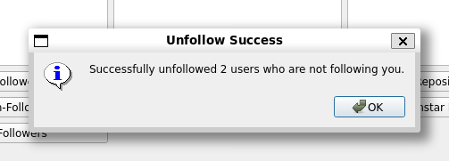

# FollowEqualizer

**FollowEqualizer** is a GitHub management tool that helps users efficiently manage their followers, repositories, and starred topics. It supports the following operations:

- Find non-followers (those you follow but who are not following you back)
- Unfollow non-followers
- Follow back users who follow you but whom you are not following
- Unstar repositories and starred topics
- Exclude specific users or repositories from actions (via exceptions)
- Multi-threaded operations for non-blocking UI updates
- Cache to improve performance on repeated operations

## **Getting Started**

Upon launching FollowEqualizer, you will see a blank GUI like the one below. This is where all the actions and results will appear once you begin interacting with the tool.



To get started:
1. Click "Find Non-Followers" to gather the list of users you follow who don't follow you back.
2. Use "Find Non-Followed Followers" to find those who follow you but aren't followed by you.
3. Click "Find Repositories to Unstar" to gather a list of starred repositories.
4. Add selected users or repositories to the exceptions list to avoid any unwanted actions.


## Features

### 1. **Multi-threading**
FollowEqualizer utilizes multi-threading to ensure a smooth user interface experience even when performing long-running API operations. For example, fetching a list of non-followers or starred repositories is done in separate threads, allowing the UI to remain responsive.

#### Example: Fetching Non-Followers



- During fetching, the UI stays responsive and updates with a message.
- Once the non-followers are fetched, the list and counters are updated.

#### Example: Non-Followers Returned



- After fetching, the non-followers are listed along with updated follower counts.

### 2. **Managing Starred Repositories**
The tool allows users to find and unstar repositories. It retrieves starred repositories and topics (if available), displaying them in a list.

#### Example: Finding Repositories to Unstar



- Users can select repositories they wish to unstar.

### 3. **Comma-separated Search**
FollowEqualizer supports a powerful search functionality that accepts comma-separated values for matching across all list boxes.

#### Example: Searching for Exceptions



- Matching users and repositories are highlighted in the lists when a search term is entered.

### 4. **Exception Management**
FollowEqualizer supports adding exceptions. Users and repositories in the exception list are excluded from the unfollow or unstar actions.

#### Example: Adding Exceptions



- You can select multiple items (users, repos) and add them to exceptions.

### 5. **Batch Actions**
You can unfollow multiple non-followers or unstar repositories/topics in bulk, with respect to the exception list.


#### Example: Performing Unfollow and Unstar Actions



- After specifying exceptions, bulk actions are performed on all the other items.

#### Example: Unfollow Success Message




- A confirmation message appears after a successful operation.

### 6. **Clear Cache**
The tool has an option to clear cached follower and repository data, ensuring the latest information is fetched from GitHub when needed.

### 7. **Caching**
FollowEqualizer caches certain API data like the list of followers and following users to avoid unnecessary calls and reduce latency. If you want to refresh the data, simply enable the "Clear Cache" checkbox before initiating a fetch operation.

## How It Works

The tool leverages the GitHub API to retrieve and manage data. Some key functionalities:

- **Multi-threading**: All major actions are performed on separate threads so that the user interface remains responsive. For instance, fetching followers, repositories, and topics doesn't block the main application window.

- **Cache**: The data retrieved from the GitHub API is cached by default to minimize repeated requests. However, if you want to refresh the data, use the "Clear Cache" option.

## Setup and Installation

### Prerequisites
- [Python 3.10 or newer](https://www.python.org/downloads/) (3.12 recommended, see `.python-version`)
- [PyGithub](https://pypi.org/project/PyGithub/) (CLI and GUI)
- [PyQt5](https://pypi.org/project/PyQt5/) (GUI only)

### Steps

1. Clone the repository:
   ```bash
   git clone https://github.com/sminerport/FollowEqualizer.git
   ```

2. Install dependencies (the GUI file pulls in the CLI dependencies too):
   ```bash
   pip install -r requirements-gui.txt   # desktop GUI
   pip install -r requirements.txt       # CLI / automation only
   ```

3. Set up your GitHub token:
   - Store your GitHub token in a `.env` file.
   - Example `.env` file:
     ```
     GITHUB_TOKEN=your_github_token_here
     ```

4. Run the application:
   ```bash
   python src/main.py
   ```

## Usage

1. **Find Non-Followers**: Press the "Find Non-Followers" button to get a list of users you follow but who are not following you back.
2. **Unfollow Non-Followers**: Use this option to unfollow non-followers. Exceptions can be applied to exclude specific users.
3. **Follow Back Non-Followed Followers**: Press this button to automatically follow back users who follow you but whom you are not following.
4. **Find Repositories to Unstar**: Press the button to retrieve a list of starred repositories. You can then choose to unstar them.
5. **Add to Exceptions**: Use this to add selected users or repositories to an exception list, preventing them from being unfollowed, followed back, or unstarred.

### Exceptions are saved to `exclude_list.json`

Every change to the Exceptions list in the GUI is written to `exclude_list.json`
at the repository root, and the list is loaded again when the app starts. The
CLI and the GitHub Actions workflow read the same file, so the people you protect
in the desktop app are protected by the automation too. **Commit the file after
you change it**, otherwise the workflow (which checks out the repository) will
not see your exceptions.

```json
{
    "users": ["someone-you-want-to-keep-following"],
    "repos": ["owner/repo-you-want-to-keep-starred"]
}
```

## Automation with CLI and GitHub Actions

In addition to the GUI, you can automate follow management from the command line.
The `src/automation.py` script exposes the same follow back and unfollow logic
used in the desktop application. Install dependencies with `pip install -r requirements.txt` and
ensure your `GITHUB_TOKEN` is available in a `.env` file.

```bash
python src/automation.py --follow-back                              # follow back
python src/automation.py --unfollow-nonfollowers --dry-run          # preview only
python src/automation.py --follow-back --unfollow-nonfollowers      # both
python src/automation.py --follow-back --exclude-file my-list.json  # custom exceptions file
```

| Flag | Effect |
|---|---|
| `--follow-back` | Follow users who follow you but whom you don't follow |
| `--unfollow-nonfollowers` | Unfollow users who don't follow you back |
| `--dry-run` | Print every user that *would* be affected, change nothing. On its own it previews both actions |
| `--exclude-file PATH` | Exceptions file (default `exclude_list.json` at the repo root) |

Every user acted on is printed by name, so the log is an audit trail. The script
exits non-zero if any single follow/unfollow fails, but keeps going through the
rest of the list, except on a 401, 403 or 429 response (bad token, missing
permission or rate limit), where it stops immediately instead of repeating the
same doomed request for every user. A malformed or unreadable exceptions file
aborts the run before anything is changed, and a missing one prints a warning.

### Token

The token in `.env` (locally) or in the `FOLLOW_EQUALIZER_TOKEN` secret (GitHub
Actions) must be allowed to change who you follow:

- Fine-grained personal access token: account permission **Followers: Read and write**.
- Classic personal access token: the `user:follow` scope.

Fine-grained tokens expire, so renew the secret when GitHub emails you.

### Running in GitHub Actions

The workflow at `.github/workflows/automation.yml`:

- **Runs daily at 09:00 UTC and only follows back.** Unfollowing is destructive, so
  it is off by default on the schedule. To include it in scheduled runs, add a
  repository variable `SCHEDULE_UNFOLLOW` with the value `true`
  (Settings → Secrets and variables → Actions → Variables).
- **Manual runs** from the Actions tab let you tick *follow back*, *unfollow
  non-followers* and *dry run* individually. A dry run is the safe way to see
  what the automation would do.
- Writes a summary of every user followed or unfollowed to the job summary page.
- Re-enables itself on every run. GitHub otherwise turns off scheduled workflows
  after 60 days without a commit to the repository.

Setup:

1. Add the secret `FOLLOW_EQUALIZER_TOKEN` under Settings → Secrets and variables → Actions.
2. Commit your `exclude_list.json`.
3. If the workflow shows as disabled in the Actions tab, enable it:
   ```bash
   gh workflow enable automation.yml
   ```
4. Do a manual *dry run* first from the Actions tab and read the summary.

A second workflow, `.github/workflows/tests.yml`, runs the unit tests on every
push and pull request on Python 3.10, 3.12 and 3.13. Its "Tests passed" job is
the check the `dev` and `main` rulesets require before a PR can merge.

## Development

```bash
pip install -r requirements.txt
python -m unittest discover -s tests -v
```

The tests use in-memory fakes for the GitHub API, so they need no token and make
no network calls.

### Branches and releases

- `dev` is the default branch; `main` is release-ready. Everything enters both
  through pull requests with a merge commit (squash is disabled), and merged
  branches are deleted automatically.
- Promote with a PR from `dev` into `main` titled `Release vX.Y.Z` (or
  `Promote ... to main` when no release follows). Never squash a promotion.
- Tag the new `main` tip to cut a release:

  ```bash
  git switch main && git pull --ff-only
  git tag -a vX.Y.Z -m "FollowEqualizer vX.Y.Z"
  git push origin vX.Y.Z
  ```

  `.github/workflows/release.yml` verifies the tag sits on `main`, re-runs the
  tests, and creates a **draft** GitHub Release with a source zip and checksums.
  Review it, then publish it from the Releases page or with
  `gh release edit vX.Y.Z --draft=false`. That click is the manual gate.
- Actions in the workflows are pinned to full commit SHAs; Dependabot bumps them weekly.

